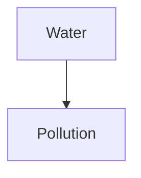
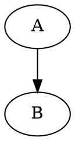

# MANUAL — Just for Fun - Encyclopedic Dictionary

`jff` es una base de conocimiento local de términos y conceptos. Cada entrada
es un archivo Markdown dentro de `~/.jff`, registrado en `map.json`, con una
TUI para leer, navegar y editar.

- **Software:** Just for Fun - Encyclopedic Dictionary
- **Binario:** `jff`
- **Creador/mantenedor:** Rodrigo Quintanar (`@perseoq`) —
  <djperseo@outlook.es>
- **Repositorio:** <https://github.com/soyperrito/jff>
- **Licencia:** GPL-3.0-only

> Este manual documenta el estado actual: CLI, TUI, imágenes, scrollbar,
> temas, matemáticas, diagramas y sincronización Git. Los renderizadores
> externos de diagramas y Git son opcionales.

---

## Índice

1. [Instalación](#1-instalación)
2. [Modelo de datos y rutas](#2-modelo-de-datos-y-rutas)
3. [Crear e importar entradas](#3-crear-e-importar-entradas)
4. [Abrir entradas en la TUI](#4-abrir-entradas-en-la-tui)
5. [Buscar y listar](#5-buscar-y-listar)
6. [Contenido relacionado](#6-contenido-relacionado)
7. [Editar](#7-editar)
8. [Borrar](#8-borrar)
9. [Configuración](#9-configuración)
10. [Temas de colores](#10-temas-de-colores)
11. [La TUI](#11-la-tui)
12. [Imágenes](#12-imágenes)
13. [Pipes y scripting](#13-pipes-y-scripting)
14. [Códigos de salida y errores](#14-códigos-de-salida-y-errores)
15. [Alias legacy](#15-alias-legacy)
16. [Solución de problemas](#16-solución-de-problemas)
17. [Matemáticas y diagramas](#17-matemáticas-y-diagramas)
18. [Git, backup y load](#18-git-backup-y-load)
19. [Empaquetado y distribución](#19-empaquetado-y-distribución)

---

## 1. Instalación

Requisitos:

- Rust 1.89 o superior.
- Terminal preferiblemente con soporte de color; para imágenes, Kitty, Sixel
  o iTerm2. Si no hay soporte gráfico se usa el fallback de half-blocks.

```sh
cargo build --release
install -Dm755 target/release/jff ~/.local/bin/jff

# binario + man page + completions
make install

# o
cargo install --path .
```

Comprobar la instalación:

```sh
jff --version
jff --help
```

La ayuda de cada subcomando:

```sh
jff help
jff help find
jff find --help
jff create --help
```

---

## 2. Modelo de datos y rutas

Hay dos tipos de entrada:

- **Term:** término.
- **Concept:** concepto.

Cada entrada tiene una **ref** única:

```text
w t 20261109123456
│ │ └─ fecha/hora local: YYYYMMDDHHMMSS
│ └─── t = term, c = concept
└───── primera letra normalizada del título
```

Ejemplos:

```text
wt20261109123456   term "Water"
wc20261109123456   concept "Water Pollution"
```

Las refs de 14 caracteres del diseño original (`wt202610112211`) también se
aceptan al leer enlaces.

### Estructura del store

```text
~/.jff/
├── config.json
├── map.json                     # registro canónico
├── .lock                        # lock de escritura
├── themes/
│   └── dracula.json
├── terms/
│   └── w/
│       └── water.md
└── concepts/
    └── w/
        └── water_pollution.md
```

`map.json` se escribe de forma atómica y protegido por un lock, para que dos
procesos no corrompan el registro.

### `JFF_HOME`

Se puede usar otro store:

```sh
export JFF_HOME=/tmp/jff-demo
jff config init
jff create -t ./inbox/water.md
```

Todos los comandos respetan `JFF_HOME`.

---

## 3. Crear e importar entradas

`create` es el **único** comando que crea entradas. `-t`/`-c` solo abren
entradas existentes.

### 3.1 Crear un término desde un archivo

```sh
jff create -t ./inbox/water.md
```

Si el archivo existe:

- Se copia su contenido al store.
- El título se toma de `title:` en front matter YAML o del primer `# H1`.
- Si no hay ninguno, se usa el nombre del archivo.
- El archivo original **no se mueve**.
- La carpeta se elige por la primera letra del título.
- El nombre destino es un slug del título.

### 3.2 Crear un concepto desde un archivo

```sh
jff create -c ./inbox/water_pollution.md
```

### 3.3 Archivo que no existe

Si pasas una ruta que no existe, `jff` crea el Markdown dentro del store:

```sh
jff create -t ./inbox/wind.md
```

Crea, por ejemplo:

```text
~/.jff/terms/w/wind.md
```

con:

```markdown
# wind

<!-- jff:ref=... kind=term created=... -->
```

### 3.4 Ejemplos de importación

```sh
# Importar un archivo con H1
jff create -t ./notes/water.md

# Importar un archivo con front matter
jff create -c ./notes/pollution.md

# Crear un término nuevo indicando solo el nombre del archivo
jff create -t ./inbox/energy.md

# Crear un concepto nuevo
jff create -c ./inbox/climate_change.md
```

### 3.5 Reglas

- Título máximo: 200 caracteres.
- No se permiten caracteres de control.
- No se permiten dos títulos iguales del mismo tipo (`term` o `concept`).
  `create` devuelve error si ya existe.
- El destino se calcula con slug ASCII, en minúsculas y sin acentos.

---

## 4. Abrir entradas en la TUI

### 4.1 Abrir un término

```sh
jff -t "Water"
jff term "Water"
jff --term "Water"
```

### 4.2 Abrir un concepto

```sh
jff -c "Water Pollution"
jff concept "Water Pollution"
jff --concept "Water Pollution"
```

### 4.3 Abrir por ref

Los tres comandos aceptan una ref:

```sh
jff -t wt20261109123456
jff -c wc20261109123456
jff -l wt20261109123456
```

Si usas una ref de concepto con `-t`, el comando falla con un mensaje claro:

```text
jff: ref `wc...` is a concept, not a term; use the matching -t/-c flag
```

### 4.4 TUI o texto

- Si `stdin` y `stdout` son terminales interactivos, `-t`/`-c` abren la TUI.
- Si la salida está canalizada o redirigida, imprimen la entrada completa:

```sh
jff -t Water | less
jff -t Water > water.txt
jff -t Water | head
```

No existen los comandos `show` ni `tui`; se eliminaron. Para abrir se usan
`-t`, `-c`, `term`, `concept` o `-l`.

### 4.5 Abrir relacionados

```sh
jff -l "Water"
jff -l wt20261109123456
```

- En terminal interactivo abre la TUI en esa entrada y muestra sus
  relacionados.
- Canalizado imprime la lista de relacionados en texto.

---

## 5. Buscar y listar

### 5.1 `find`

```sh
jff find <QUERY>
```

Opciones:

```text
--kind term|concept
--exact
--json
```

Ejemplos:

```sh
jff find water
jff find "water pollution"
jff find water --kind term
jff find water --kind concept
jff find "water" --exact
jff find water --json
jff find water --exact --json
```

Salida normal: una línea por entrada, separada por tabs:

```text
wt20261109123456	term	Water
wc20261109123456	concept	Water Pollution
```

La búsqueda:

- Ignora mayúsculas y acentos.
- `--exact` exige igualdad normalizada.
- Sin `--exact`, prioriza igualdad, luego prefijo, luego contenido.
- Devuelve código `1` si no hay coincidencias.

### 5.2 `list`

```sh
jff list
jff list --kind term
jff list --kind concept
jff list --letter w
jff list --kind term --letter w
jff list --json
```

Salida normal: `ref`, `kind`, `title` separados por tabs.

### 5.3 Alias de búsqueda

```sh
jff -set "water"                  # término exacto
jff -sec "water pollution"         # concepto exacto
jff -st "water"                   # buscar términos
jff -sc "water"                   # buscar conceptos
```

`-set`/`-sec` equivalen a `find ... --exact`; `-st`/`-sc` equivalen a
`find ... --kind ...`.

### 5.4 Listar archivos

```sh
jff list --json | jq -r '.[].path'
```

---

## 6. Contenido relacionado

Dentro de un Markdown puedes enlazar otras entradas:

```markdown
[more:term](../../terms/w/water.md)
[more:concept](../../concepts/w/water_pollution.md)
[more:term](jff:wt20261109123456)
[more:concept](wc20261109123456)
```

También existen los alias cortos:

```markdown
[more:t](../../terms/w/water.md)
[more:c](../../concepts/w/water_pollution.md)
[more:t](jff:wt20261109123456)
[more:c](wc20261109123456)
```

Reglas:

- Las rutas relativas se resuelven desde el archivo Markdown actual.
- La ruta debe quedar dentro de `~/.jff`.
- Se acepta una ref como destino.
- El panel de relacionados muestra el **primer H1** del archivo destino, no el
  título del registro.
- Los enlaces rotos se muestran como `[missing]`.

### 6.1 `related`

```sh
jff related "Water"
jff related water --kind term
jff related water --kind concept
jff related wt20261109123456
jff related water --json
jff related water --kind term --json
```

Salida de texto:

```text
Water (term, wt...)
  Water contamination	wc...	concept	-> concepts/w/water_pollution.md
  [missing]	term	more:term	-> terms/w/missing.md
```

`related` es solo texto/JSON. Para abrir la vista de relacionados en la TUI se
usa `-l`.

### 6.2 Alias

```sh
jff -srt "water"                 # relacionados de un término
jff -src "water pollution"        # relacionados de un concepto
```

---

## 7. Editar

```sh
jff edit <REF>
jff edit <REF> --editor nano
jff edit <REF> --editor vim
jff edit <REF> --editor code
jff edit <REF> --editor emacs
jff edit <REF> --editor custom
```

- `nano`: nano.
- `vim`: prefiere `nvim` si está instalado; si no, `vim`.
- `code`: Visual Studio Code con `--wait`.
- `emacs`: emacs.
- `custom`: usa `editor.name`/`editor.path` de `config.json`.

Desde la TUI, `e` edita la entrada actual: suspende la TUI, lanza el editor y
recarga al volver.

Alias legacy:

```sh
jff -en <REF>   # nano
jff -ev <REF>   # vim/nvim
jff -ec <REF>   # code
jff -ee <REF>   # emacs
jff -eo <REF>   # editor personalizado
```

---

## 8. Borrar

```sh
jff delete <REF>
jff -d <REF>
jff -dt <REF>
jff -dc <REF>
```

Borra la entrada de `map.json` y elimina el archivo Markdown asociado.

Ejemplo:

```sh
jff delete wt20261109123456
```

Para borrar es obligatorio usar la **ref**, no el `id` interno.

---

## 9. Configuración

Rutas:

```sh
jff config path       # imprime ~/.jff/config.json
jff config init       # crea config.json y el directorio themes/
jff config show       # imprime la configuración efectiva, con tema aplicado
```

`config init` no sobrescribe una configuración existente.

### 9.1 Configuración completa

```json
{
  "editor": {
    "name": "nano",
    "path": null
  },
  "images": {
    "enable": true,
    "mime": ["jpg", "jpeg", "png"],
    "exclude": ["gif", "webp"],
    "max_size_kb": 10240,
    "max_pixels": 40000000
  },
  "git": {
    "repo": null,
    "autopush": false,
    "user": null,
    "email": null,
    "token_env": "JFF_GIT_TOKEN"
  },
  "colors": {
    "theme": null,
    "title": "#FFFF00",
    "text": "#FFFFFF",
    "muted": "#808080",
    "border": "#808080",
    "accent": "#00FFFF",
    "related": "#C0C0C0",
    "status": "#00FFFF",
    "error": "#FF5555",
    "code": "#C0C0C0",
    "code_bg": "#303030",
    "image": "#C0C0C0",
    "math": "#F1FA8C",
    "diagram": "#FF79C6",
    "highlight_fg": "#FFFFFF",
    "highlight_bg": "#444444",
    "scrollbar": "#444444",
    "scrollbar_thumb": "#00FFFF"
  },
  "border-style": {
    "line": "double",
    "border": 1
  },
  "font": {
    "title": { "family": "sans-serif", "weight": 400, "size": "30px" },
    "text": { "family": "sans-serif", "weight": 400, "size": "10pt" },
    "related": { "family": "sans-serif", "weight": 400, "size": "10pt" }
  }
}
```

Notas:

- Para usar un tema, reemplaza todo el bloque `colors` por
  `{ "theme": "themes/dracula.json" }`. Los colores inline se ignoran
  automáticamente; consulta la sección 10.
- `git` está reservado para la fase 3; el autopush todavía no está
  implementado.
- `font` está reservado para un futuro renderizador gráfico; una TUI no usa
  familias ni tamaños tipográficos.
- `border-style.line` acepta `single`, `plain`, `rounded`, `thick` y `double`.
- Los valores de color aceptan `#RRGGBB`, nombres ANSI (`red`, `dark-gray`),
  índices (`42`) y `default`/`reset`.

### 9.2 Colores

| Clave | Uso |
|---|---|
| `title` | Título de entrada y encabezados Markdown |
| `text` | Texto normal y títulos de paneles |
| `muted` | Metadatos, ayudas, kind/ref |
| `border` | Marcos, reglas y separadores |
| `accent` | Marco enfocado, enlaces, énfasis de código |
| `related` | Etiquetas de relacionados |
| `status` | Mensajes de estado |
| `error` | Enlaces rotos y errores |
| `code` / `code_bg` | Código inline y bloques de código |
| `image` | Caption/placeholder de imágenes |
| `math` | Fórmulas inline y en bloque |
| `diagram` | Etiquetas y fuente de diagramas |
| `highlight_fg` / `highlight_bg` | Fila seleccionada |
| `scrollbar` / `scrollbar_thumb` | Scrollbar del contenido |

---

## 10. Temas de colores

### 10.1 Cómo cambiar los colores usando un tema

1. Copia los temas al store:

   ```sh
   mkdir -p ~/.jff/themes
   cp themes/*.json ~/.jff/themes/
   ```

2. Edita `~/.jff/config.json` y deja **solo** el tema dentro de `colors`:

   ```json
   {
     "colors": {
       "theme": "themes/dracula.json"
     }
   }
   ```

3. Verifica la paleta efectiva:

   ```sh
   jff config show | jq '.colors'
   ```

4. Abre la TUI:

   ```sh
   jff -t Water
   ```

**Importante:** no hay una opción adicional para “desactivar los colores por
defecto”. En cuanto defines `colors.theme`, todos los colores inline de
`config.json` se ignoran automáticamente. Se recomienda borrar las claves
inline para que no haya confusión. Si quieres volver a los colores inline,
pon `"theme": null` y añade las claves que necesites.

### 10.2 Estructura del tema

Cuando `theme` está definido:

- Se ignoran **todos** los colores inline de `config.json`.
- Se carga la paleta del archivo indicado.
- Las claves que falten en el tema usan el default, no los inline.
- La ruta puede ser relativa a `~/.jff`, usar `~/...` o ser absoluta.

Archivo de tema plano:

```json
{
  "title": "#BD93F9",
  "text": "#F8F8F2",
  "border": "#6272A4"
}
```

También se acepta envuelto en `colors`:

```json
{
  "colors": {
    "title": "#BD93F9",
    "text": "#F8F8F2",
    "border": "#6272A4"
  }
}
```

### 10.3 Temas incluidos

Temas incluidos en el repositorio:

| Tema | Archivo |
|---|---|
| Dracula | `themes/dracula.json` |
| Monokai Pro | `themes/monokai.json` |
| Nord | `themes/nord.json` |
| Forrest | `themes/forrest.json` |
| Hacker | `themes/hacker.json` |

```sh
mkdir -p ~/.jff/themes
cp themes/*.json ~/.jff/themes/
```

Configurar uno:

```json
{
  "colors": {
    "theme": "themes/nord.json"
  }
}
```

Cambiar de tema es simplemente cambiar el valor de `theme` y reiniciar la TUI.

Ver la configuración efectiva:

```sh
jff config show | jq '.colors'
```

Si el tema no existe o tiene JSON inválido, el comando falla:

```text
jff: theme error: cannot read theme `.../themes/dracula.json`: No such file or directory
```

---

## 11. La TUI

### 11.1 Abrir

```sh
jff -t Water
jff -c "Water Pollution"
jff -l Water
jff term Water
jff concept "Water Pollution"
```

### 11.2 Teclas

| Tecla | Acción |
|---|---|
| `Tab` | cambiar foco contenido/relacionados |
| `↑` / `↓`, `j` / `k` | scroll o mover selección |
| Rueda del ratón | scroll o mover selección |
| `PgUp` / `PgDn`, `Space` | página |
| `Ctrl+u` / `Ctrl+d` | página |
| `g` / `G`, `Home` / `End` | inicio/final |
| `Enter` | enfocar relacionados o abrir el seleccionado |
| `←` / `h` | volver en el historial |
| `e` | editar con el editor configurado |
| `r` | recargar la entrada |
| `Esc` / `Backspace` | volver; salir en la raíz |
| `q` | salir |
| `?` | ayuda de teclas |

La columna derecha del panel **Content** muestra una scrollbar. Los colores
del track y del thumb se configuran con `scrollbar` y `scrollbar_thumb`.

### 11.3 Imágenes en la TUI

Las imágenes se renderizan inline cuando están completamente visibles. Si se
hacen scroll parcial se muestra un placeholder. Se usan Kitty, Sixel o iTerm2
si el terminal los soporta; si no, half-blocks.

---

## 12. Imágenes

Sintaxis Markdown:

```markdown

```

Reglas:

- La ruta es relativa al Markdown que contiene la imagen.
- Debe estar dentro de `~/.jff`.
- Se aceptan rutas absolutas dentro del store.
- Los tipos permitidos y excluidos se configuran en `images.mime` y
  `images.exclude`.
- Límites:
  - `max_size_kb`: tamaño del archivo; `0` desactiva.
  - `max_pixels`: píxeles decodificados; `0` desactiva.
- Por defecto se permiten `jpg`, `jpeg`, `png` y se excluyen `gif`, `webp`.
- Errores posibles: archivo inexistente, ruta fuera del store, tipo excluido,
  tamaño excedido, demasiados píxeles, formato inválido.

Ejemplo de configuración:

```json
{
  "images": {
    "enable": true,
    "mime": ["jpg", "jpeg", "png", "gif", "webp"],
    "exclude": [],
    "max_size_kb": 20480,
    "max_pixels": 80000000
  }
}
```

---

## 13. Pipes y scripting

`jff` detecta si la salida es un terminal. Si está canalizada:

- `-t`/`-c` imprimen la entrada completa.
- `-l` imprime la lista de relacionados.
- `find`/`list`/`related` ya imprimen texto por defecto.
- `--json` devuelve JSON utilizable con `jq`.

### 13.1 Leer contenido

```sh
jff -t Water | less -R
jff -t Water | head -n 20
jff -t Water | tail -n 20
jff -t Water | wc -l
jff -t Water | grep -n '^#'
jff -t Water | sed -n '1,15p'
jff -t Water > /tmp/water.txt
```

### 13.2 Buscar y filtrar

```sh
jff find water | grep -i pollution
jff find water | awk -F '\t' '{print $1 "\t" $3}'
jff list | cut -f1 | head -n 5
jff list | wc -l
jff -set water | cut -f1
jff -l Water | grep -i 'concept\|term'
```

### 13.3 Extraer una ref y abrirla

```sh
REF=$(jff -set water | cut -f1)
jff -t "$REF" | less

REF=$(jff find water --json | jq -r '.[0].ref')
jff -t "$REF" | head -n 30
```

### 13.4 JSON con `jq`

`find` y `list` devuelven un array de entradas:

```json
[
  {
    "id": 1,
    "ref": "wt...",
    "kind": "term",
    "title": "Water",
    "letter": "w",
    "path": "terms/w/water.md",
    "created_at": "2026-11-09T12:00:00Z"
  }
]
```

Ejemplos:

```sh
jff list --json | jq -r '.[] | [.kind, .ref, .title] | @tsv'
jff list --json | jq -r '.[] | select(.kind == "concept") | .title'
jff list --json | jq -r '.[].ref'
jff list --json | jq 'length'
jff find water --json | jq '.[0]'
jff find water --json | jq -r '.[].path'
jff list --json | jq -r '.[] | "\(.kind)\t\(.ref)\t\(.title)"' | column -t -s $'\t'
```

Comprobar si existe algo:

```sh
if jff -set water >/dev/null; then
  echo "existe"
else
  echo "no existe"
fi
```

### 13.5 Relacionados con `jq`

`related` devuelve:

```json
{
  "entry": { "...": "..." },
  "related": [
    {
      "heading": "Water contamination",
      "link": {
        "dest": "../../concepts/w/water_pollution.md",
        "label": "more:concept",
        "type": "concept"
      },
      "target": { "...": "..." }
    }
  ]
}
```

Ejemplos:

```sh
jff related water --json | jq -r '.related[].heading'
jff related water --json | jq -r '.related[] | select(.target != null) | .target.ref'
jff related water --json | jq -r '.related[] | select(.target == null) | .link.dest'
jff -l water | grep -i 'missing'
```

### 13.6 Recorrer entradas

```sh
jff list --json | jq -r '.[].ref' |
while read -r ref; do
  echo "== $ref"
  jff -t "$ref" | head -n 5
done
```

```sh
jff list | cut -f1 | xargs -I{} sh -c 'echo "== {}"; jff -t "{}" | head -n 3'
```

### 13.7 Rutas de archivos

Las rutas de `map.json` son relativas a `~/.jff`:

```sh
jff list --json | jq -r '.[].path' |
while read -r path; do
  echo "$HOME/.jff/$path"
done
```

Con `JFF_HOME`:

```sh
jff list --json | jq -r '.[].path' |
while read -r path; do
  echo "$JFF_HOME/$path"
done
```

### 13.8 `fzf` opcional

Si tienes `fzf`:

```sh
jff list --json | jq -r '.[].ref' |
fzf --preview 'jff -t {} | head -n 60'
```

### 13.9 Configuración y temas

```sh
jff config path
jff config path | xargs cat
jff config show | jq '.colors'
jff config show | jq -r '.colors.theme'
jff config show | jq '.colors.scrollbar_thumb'
```

### 13.10 Redirecciones útiles

```sh
jff list > /tmp/jff-list.txt
jff find water --json > /tmp/water.json
jff -t Water > /tmp/water.md
jff related water --json > /tmp/water-related.json
```

---

## 14. Códigos de salida y errores

| Código | Significado |
|---|---|
| `0` | Éxito |
| `1` | Error, entrada no encontrada o búsqueda sin coincidencias |
| `2` | Error de uso/argumentos de `clap` |

Ejemplos:

```sh
jff -set nothing
echo $?        # 1

jff -t "No existe"
echo $?        # 1

jff create -t archivo.md
echo $?        # 0 si se creó/importó
```

Errores habituales:

- `no term titled ...; create it with jff create -t <file.md>`
- `ref ... is a concept, not a term`
- `an entry titled ... already exists`
- `theme error: ...`
- `image type ... is excluded`
- `image is too large`
- `image has too many pixels`
- `image path is outside the knowledge base`

---

## 15. Alias legacy

| Alias | Equivalente actual |
|---|---|
| `jff -t <title\|ref>` | `jff term <title\|ref>` |
| `jff -c <title\|ref>` | `jff concept <title\|ref>` |
| `jff -l <title\|ref>` | TUI de relacionados / `jff related` en texto |
| `jff -d <ref>` | `jff delete <ref>` |
| `jff -set <title>` | `jff find <title> --kind term --exact` |
| `jff -sec <title>` | `jff find <title> --kind concept --exact` |
| `jff -st <query>` | `jff find <query> --kind term` |
| `jff -sc <query>` | `jff find <query> --kind concept` |
| `jff -srt <query>` | `jff related <query> --kind term` |
| `jff -src <query>` | `jff related <query> --kind concept` |
| `jff -dt <ref>` / `-dc <ref>` | `jff delete <ref>` |
| `jff -en <ref>` | `jff edit <ref> --editor nano` |
| `jff -ev <ref>` | `jff edit <ref> --editor vim` |
| `jff -ec <ref>` | `jff edit <ref> --editor code` |
| `jff -ee <ref>` | `jff edit <ref> --editor emacs` |
| `jff -eo <ref>` | `jff edit <ref> --editor custom` |

---

## 16. Solución de problemas

### La TUI no abre y sale texto

`-t`/`-c` solo abren la TUI si `stdin` y `stdout` son terminales. Si estás
canalizando o redirigiendo, es intencional:

```sh
jff -t Water | cat   # fuerza salida de texto
```

### La imagen no aparece

- Comprueba que está dentro de `~/.jff`.
- Revisa `images.enable`, `images.mime`, `images.exclude`.
- Revisa `max_size_kb` y `max_pixels`.
- Algunos terminales no soportan Kitty/Sixel/iTerm2; se usa half-blocks.
- Haz scroll hasta que la imagen esté completamente visible.

### El tema no carga

- Comprueba la ruta en `colors.theme`.
- Si es relativa, se resuelve desde `~/.jff`.
- Verifica que el JSON sea válido.
- Prueba `jff config show | jq '.colors'`.

### El registro no refleja un cambio

```sh
jff config show
```

En la TUI pulsa `r` para recargar. Para reparar el registro, haz una copia de
`map.json` antes de editarlo manualmente.

### No se encuentra una entrada por título

`-t`/`-c` usan coincidencia exacta normalizada. Usa `find` para búsquedas
parciales:

```sh
jff find water
jff find water --json
```

### Editor personalizado

```json
{
  "editor": {
    "name": "mi-editor",
    "path": "/usr/local/bin/mi-editor"
  }
}
```

```sh
jff edit <ref> --editor custom
jff -eo <ref>
```

### Git no respalda o carga

Comprueba:

```sh
jff config show | jq '.git'
git -C ~/.jff status
git -C ~/.jff remote -v
```

- `git.repo` debe estar configurado.
- Si usas HTTPS, exporta `JFF_GIT_TOKEN` o el nombre configurado en
  `token_env`.
- Si hay conflicto, sigue los pasos de la sección 18.5.
- Un fallo de autopush no pierde cambios locales; ejecuta `jff backup` después
  de corregir el problema.
- Para traer datos remotos, usa `jff load`.

### Una fórmula no se ve bien

`unicodeit` cubre una parte de LaTeX. Las construcciones complejas pueden
quedar como texto parcial; el contenido original sigue visible en el Markdown.

### Un diagrama muestra solo la fuente

Instala la herramienta correspondiente:

```sh
command -v mmdc
command -v dot
command -v typst
```

Sin herramienta, `jff` muestra la fuente del diagrama como fallback.

---

## 17. Matemáticas y diagramas

### 17.1 Fórmulas inline

```markdown
La energía es $E=mc^2$ y la identidad de Euler es $e^{i\pi}+1=0$.
```

`jff` convierte sintaxis LaTeX a Unicode con `unicodeit` y las muestra con el
color `math`. Las fórmulas complejas pueden quedar parcialmente convertidas,
pero el texto sigue siendo legible.

### 17.2 Fórmulas en bloque

```markdown
$$
\alpha + \beta = \gamma
$$
```

Se muestran como una línea independiente, indentada y con el color `math`.

### 17.3 Diagramas

Bloques de código reconocidos:

````markdown

````

````markdown

````

````markdown
```typst
#set page(width: 10cm, height: auto)
= Diagram
```
````

Comportamiento:

- `mermaid` / `mmd` usa `mmdc`.
- `dot` / `graphviz` usa `dot`.
- `typst` usa `typst`.
- Si la herramienta no está instalada, se muestra la fuente del diagrama con
  las etiquetas y colores `diagram`/`code`.
- Si la herramienta está instalada pero falla, se muestra el error y la fuente.
- Las imágenes generadas se guardan en `~/.jff/.cache/diagrams/`.
- Los colores se controlan con `math` y `diagram` en `colors` o en el tema.

Comprobar herramientas:

```sh
command -v mmdc
command -v dot
command -v typst
```

---

## 18. Git, backup y load

### 18.1 Configuración

```json
{
  "git": {
    "repo": "https://github.com/soyperrito/jff.git",
    "autopush": true,
    "user": "Rodrigo Quintanar",
    "email": "djperseo@outlook.es",
    "token_env": "JFF_GIT_TOKEN"
  }
}
```

- `repo`: URL del remoto.
- `autopush`: ejecuta `jff backup` automáticamente después de `create`,
  `delete` y `edit`.
- `user` / `email`: identidad usada en los commits.
- `token_env`: nombre de la variable de entorno que contiene el token HTTPS.
  La contraseña/token **no** se guarda en `config.json`.

### 18.2 Backup manual

```sh
export JFF_GIT_TOKEN="tu_token"
jff backup
```

`jff backup`:

1. Inicializa `~/.jff` como repositorio Git si hace falta.
2. Configura `origin`.
3. Crea/actualiza `.gitignore` con `.lock`, `.cache/` y `*.tmp`.
4. Hace `git add -A`.
5. Crea un commit con la identidad configurada.
6. Hace `fetch` y `pull --rebase --autostash`.
7. Hace `push` a `origin`.

El primer backup contra un remoto vacío crea la rama `main`.

### 18.3 Autopush

Con `"autopush": true`, `jff` ejecuta un backup después de:

```sh
jff create -t archivo.md
jff create -c archivo.md
jff delete <ref>
jff edit <ref>
jff -t Water        # edición desde la TUI: suspende, edita y respalda
```

Si el autopush falla, la operación local no se pierde: se muestra una
advertencia y el cambio queda en el store para el siguiente `jff backup`.

### 18.4 Load desde el remoto

```sh
jff load
```

`jff load` carga desde `git.repo` los archivos:

- `map.json`
- `terms/`
- `concepts/`

Comportamiento:

- Si `~/.jff` ya es un repositorio Git:
  - Hace `fetch` y `pull --rebase`.
  - Se niega a continuar si `map.json`, `terms/` o `concepts/` tienen cambios
    tracked sin respaldar; ejecuta antes `jff backup`.
  - Si hay conflicto, aborta el rebase y devuelve error.
- Si `~/.jff` no es un repositorio Git:
  - Clona el remoto en un directorio temporal.
  - Exige que el remoto contenga `map.json`.
  - Copia el contenido local de `map.json`, `terms/`, `concepts/`,
    `config.json` y `themes/` a
    `~/.jff/.cache/load-backup-<timestamp>/`.
  - Reemplaza `map.json`, `terms/` y `concepts/` con los del remoto.
  - Copia el `.git` del clon para que los siguientes backups sigan la misma
    historia.
  - Restaura `config.json` y `themes/` locales para no perder la configuración
    ni los temas instalados.
  - Crea `terms/` y `concepts/` si no existen.
- El comando imprime la ruta del backup local si se creó uno.

### 18.5 Conflictos del backup

Antes de hacer push se ejecuta un rebase sobre el remoto. Si hay conflicto:

- Se aborta el rebase.
- Se devuelve un error indicando que hay que resolverlo.
- Los cambios locales se conservan.

Resolución:

```sh
cd ~/.jff
git pull --rebase origin main
# resolver archivos en conflicto
git add <archivos>
git rebase --continue
jff backup
```

### 18.6 Inspección

```sh
git -C ~/.jff status
git -C ~/.jff log --oneline
git -C ~/.jff remote -v
jff config show | jq '.git'
```

---

## 19. Empaquetado y distribución

### 19.1 Shell completions

```sh
jff completions bash > jff.bash
jff completions zsh > _jff
jff completions fish > jff.fish
jff completions powershell > jff.ps1
jff completions elvish > jff.elv
```

Instalación típica:

```sh
# Bash
mkdir -p ~/.local/share/bash-completion/completions
jff completions bash > ~/.local/share/bash-completion/completions/jff

# Zsh
mkdir -p ~/.local/share/zsh/site-functions
jff completions zsh > ~/.local/share/zsh/site-functions/_jff

# Fish
mkdir -p ~/.config/fish/completions
jff completions fish > ~/.config/fish/completions/jff.fish
```

### 19.2 Man page

```sh
jff man > jff.1
man -l jff.1
```

Instalación:

```sh
sudo install -Dm644 jff.1 /usr/local/share/man/man1/jff.1
sudo mandb
```

### 19.3 Makefile

```sh
make build        # cargo build --release --locked
make test
make fmt
make clippy
make completions  # genera completions/
make man          # genera man/jff.1
make packages     # genera .deb y .rpm (requiere nfpm)
make install      # binario + man + completions
make uninstall
make clean
```

Variables:

```sh
make install PREFIX=/usr/local
make install DESTDIR=/tmp/pkg
```

### 19.4 CI

`.github/workflows/ci.yml` ejecuta en cada push/PR:

- `cargo fmt --check`
- `cargo clippy --all-targets -- -D warnings`
- `cargo test --all-targets`
- `cargo build --release --locked`
- Smoke test de `completions` y `man`

### 19.5 Releases

Un tag `v*` dispara `.github/workflows/release.yml`, que compila y publica:

- Linux x86_64
- macOS ARM64
- Windows x86_64

Cada archivo incluye:

- binario `jff`
- `README.md`
- `MANUAL.md`
- `LICENSE`
- `NOTICE`
- completions de bash, zsh y fish
- `man/jff.1`
- directorio `themes/` con los temas incluidos

Además se generan paquetes nativos:

- `dist/jff_<version>-1_amd64.deb`
- `dist/jff-<version>-1.x86_64.rpm`

### 19.6 Paquetes .deb y .rpm

```sh
make packages
# o
NFPM_BIN=nfpm scripts/build-packages.sh
```

Los paquetes:

- instalan `jff` en `/usr/local/bin/jff`;
- instalan los temas en `/usr/local/share/jff/themes/`;
- instalan `config.default.json`, man page y completions;
- declaran dependencias: `git`, `nano`, `ca-certificates`, `libc` y `libgcc`;
- recomiendan `graphviz` y sugieren `typst`/`mermaid-cli`;
- ejecutan un `postinstall` que crea `~/.jff/config.json` y copia los temas
  para los usuarios existentes y `/etc/skel`, sin sobrescribir archivos del
  usuario.

Si no tienes `nfpm`:

```sh
curl -fsSL https://github.com/goreleaser/nfpm/releases/download/v2.48.0/nfpm_2.48.0_Linux_x86_64.tar.gz |
  sudo tar -xz -C /usr/local/bin nfpm
```

Ejemplo:

```sh
git tag v0.1.0
git push origin v0.1.0
```

---

## Licencia

Copyright (C) 2026 Rodrigo Quintanar.

Software: **Just for Fun - Encyclopedic Dictionary**.

Este programa es software libre bajo la GNU General Public License, versión 3
(GPL-3.0-only). Consulta `LICENSE` para el texto completo.

- GitHub: <https://github.com/soyperrito/jff>
- Mantenedor: Rodrigo Quintanar — `@perseoq` — <djperseo@outlook.es>
