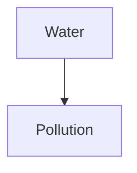

# Just for Fun - Encyclopedic Dictionary

`jff` is a local, Markdown-based encyclopedia for terms and concepts. It
combines a command-line interface with a terminal UI for reading, searching,
navigating and editing your knowledge base.

- Binary: `jff`
- Store: `~/.jff`
- Full reference: [MANUAL.md](MANUAL.md)

## Installation

### Packages

Download the `.deb` or `.rpm` from the releases page:

```sh
sudo apt install ./jff_*.deb
sudo dnf install ./jff-*.rpm
```

The packages install:

- `/usr/local/bin/jff`
- themes under `/usr/local/share/jff/themes/`
- man page and bash/zsh/fish completions
- a default `~/.jff/config.json` and themes for existing users and `/etc/skel`

### From source

```sh
git clone https://github.com/soyperrito/jff.git
cd jff
cargo install --path .
```

Requirements: Rust 1.89 or newer. Optional tools:

- `git` for `jff backup` / `jff load`
- `nano`, `vim`, `code` or `emacs` for editing
- `graphviz`, `mmdc` or `typst` for rendering diagrams

## Quick start

```sh
# Create/import content
jff create -t ./inbox/water.md
jff create -c ./inbox/water_pollution.md

# Open an entry in the TUI
jff -t "Water"
jff -c "Water pollution"

# Open by ref
jff -t wt20261109123456

# Related content
jff -l water

# Search
jff -set water
jff -sec "water pollution"
jff find water --kind concept

# Backup / load
jff backup
jff load
```

## Commands

```text
jff term <TITLE|REF>              Open a term
jff concept <TITLE|REF>           Open a concept
jff create -t|-c <FILE>           Create/import a term or concept
jff list [--kind ...] [--letter L] [--json]
jff find <QUERY> [--kind ...] [--exact] [--json]
jff related <QUERY> [--kind ...] [--json]
jff delete <REF>
jff edit <REF> [--editor nano|vim|code|emacs|custom]
jff backup                        Commit and push the knowledge base
jff load                          Load map.json, terms/ and concepts/ from the remote
jff index                         Register manual files under terms/ and concepts/
jff completions bash|zsh|fish|powershell|elvish
jff man
jff config path|init|show
```

`-t`/`-c` open an existing entry; they do not create one. Use `create` for that.
When output is piped, `-t`/`-c` print the entry and `-l` prints the related
list.

## Storage

```text
~/.jff/
├── config.json
├── map.json
├── themes/
│   └── dracula.json
├── terms/
│   └── w/
│       └── water.md
└── concepts/
    └── w/
        └── water_pollution.md
```

Use `JFF_HOME` for an alternative store:

```sh
JFF_HOME=/tmp/jff-demo jff create -t ./water.md
```

A ref has the form `[letter][type][YYYYMMDDHHMMSS]`, for example
`wt20261109123456`.

## Creating entries

`jff create -t FILE` and `jff create -c FILE` create or import an entry:

- if the file exists, its content is copied;
- the title comes from YAML front matter (`title:`) or the first `# H1`, then
  the file name;
- if the file does not exist, a new Markdown file is created in the store;
- the destination folder is chosen from the first letter of the title;
- duplicate titles of the same type are rejected.

If you edit or add Markdown files directly under `~/.jff/terms/` or
`~/.jff/concepts/`, register them with:

```sh
jff index
```

`jff index` scans both trees, registers unindexed `.md`/`.markdown` files **in
place** (without moving them), skips files already present in `map.json`, and
reports duplicate titles. It uses the same title rules: front matter `title:`,
first `# H1`, then file name. If `git.autopush` is enabled, the new entries are
backed up afterwards.

## Terminal UI

Keys:

| Key | Action |
|---|---|
| `Tab` | switch content/related focus |
| `↑`/`↓`, `j`/`k` | scroll or select |
| mouse wheel | scroll or select |
| `PgUp`/`PgDn`, `Space`, `Ctrl+u`/`Ctrl+d` | page |
| `g`/`G`, `Home`/`End` | top/bottom |
| `Enter` | open selected related entry |
| `←` / `h`, `Ctrl+←` / `Alt+←` | back in history |
| `Esc` / `Backspace` | back; quit at the root |
| `e` | edit |
| `r` | reload |
| `q` | quit |
| `?` | key help |

The content pane has a scrollbar on the right. Markdown, code blocks, tables,
images, math and diagrams are rendered in the viewer.

## Related links

In any Markdown file:

```markdown
[more:term](../../terms/w/water.md)
[more:concept](../../concepts/w/water_pollution.md)
[more:term](jff:wt20261109123456)
[more:t](wt20261109123456)
[more:c](wc20261109123456)
[more:c](/concepts/w/water_pollution.md)
```

Relative paths and leading-slash store paths such as `/concepts/...` are
accepted. The related pane shows the first `# H1` of each target file.
Unresolved links are shown as `[missing]`.

## Search and listing

```sh
jff list
jff list --kind term --letter w
jff list --json
jff find water --exact
jff find water --kind concept
jff find water --json
jff -st water
jff -sc water
jff -srt water
jff -src "water pollution"
```

Search ignores case and accents. `--json` is available for scripts.

## Images, math and diagrams

Images:

```markdown


```

Local images must stay inside `~/.jff`. `http://` and `https://` images are
downloaded once and cached under `~/.jff/.cache/images/`. Supported types and
size limits are configured in `config.json`.

Math:

```markdown
$E=mc^2$
```

Fenced diagram blocks:

````markdown

````

`mermaid`, `dot`/`graphviz` and `typst` use external tools when available;
otherwise the source is shown.

## Configuration

`jff config init` creates `~/.jff/config.json`. `jff config show` prints the
effective configuration. A minimal example:

```json
{
  "editor": {
    "name": "nano",
    "path": null
  },
  "images": {
    "enable": true,
    "mime": ["jpg", "jpeg", "png"],
    "exclude": ["gif", "webp"],
    "max_size_kb": 10240,
    "max_pixels": 40000000
  },
  "git": {
    "repo": "https://github.com/soyperrito/jff.git",
    "autopush": true,
    "user": "Rodrigo Quintanar",
    "email": "djperseo@outlook.es",
    "token_env": "JFF_GIT_TOKEN"
  },
  "colors": {
    "theme": "themes/dracula.json"
  },
  "border-style": {
    "line": "double",
    "border": 1
  }
}
```

When `colors.theme` is set, inline color keys are ignored and the theme palette
is used. Relative theme paths resolve from `~/.jff`.

Included themes:

- `themes/dracula.json`
- `themes/monokai.json`
- `themes/nord.json`
- `themes/forrest.json`
- `themes/hacker.json`

```sh
mkdir -p ~/.jff/themes
cp themes/*.json ~/.jff/themes/
```

The token for HTTPS Git operations is read from `token_env`; it is never stored
in `config.json`.

## Backup and load

```sh
jff backup
jff load
```

- `jff backup` commits local changes and pushes them to `git.repo`.
- `jff load` loads `map.json`, `terms/` and `concepts/` from the remote.
  If the local store is not a repository, it clones to a temporary directory,
  backs up existing data to `.cache/load-backup-<timestamp>/`, and preserves
  local `config.json` and `themes/`.

With `autopush: true`, backup runs automatically after `create`, `delete` and
`edit`.

## Completions and man page

```sh
jff completions bash > ~/.local/share/bash-completion/completions/jff
jff completions zsh  > ~/.local/share/zsh/site-functions/_jff
jff completions fish > ~/.config/fish/completions/jff.fish
jff man > jff.1
```

## Pipes

When output is piped, entries are printed as text and related results as a
tab-separated list:

```sh
jff -t Water | less
jff -l Water | grep -i pollution
jff find water --json | jq -r '.[] | [.ref, .kind, .title] | @tsv'
jff list --json | jq -r '.[].ref'
```

`find` exits with code `1` when there are no matches.

## License

Copyright (C) 2026 Rodrigo Quintanar.

GPL-3.0-only. See [LICENSE](LICENSE).

- Maintainer: Rodrigo Quintanar — [@perseoq](https://github.com/perseoq) —
  <djperseo@outlook.es>
- Repository: <https://github.com/soyperrito/jff>
