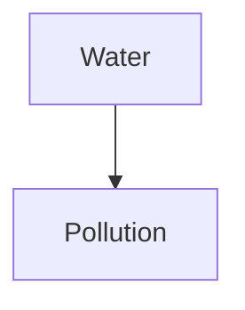

# Just for Fun - Encyclopedic Dictionary

**Just for Fun - Encyclopedic Dictionary** (`jff`) — a local, Markdown-based
knowledge base for terms and concepts.

`jff` stores every term or concept as a Markdown file inside `~/.jff`, keeps a
small JSON registry, and gives you fast exact, fuzzy and link-based search from
the terminal.

> Status: **MVP CLI + TUI, phases 0-4 complete**. Development builds and
> release packaging are configured in CI.

Full command reference, themes, images and pipe examples:
[MANUAL.md](MANUAL.md).

## Requirements

- Rust 1.89 or newer (edition 2024)
- `git` for synchronization (optional)
- `mmdc`, `dot` or `typst` for diagram rendering (optional)

## Build and install

```sh
cargo build --release
install -Dm755 target/release/jff ~/.local/bin/jff

# or install binary, man page and completions
make install

# or
cargo install --path .
```

Generate packaging artifacts explicitly:

```sh
jff completions bash > jff.bash
jff completions zsh > _jff
jff completions fish > jff.fish
jff man > jff.1
```

## Quick start

```sh
# Creation/import: use `create`
jff create -t ./inbox/water.md
jff create -c ./inbox/water_pollution.md

# Open an existing term/concept in the TUI
jff -t "Water"
jff -c "Water pollution"

# Show everything related through [more:...] links
# (opens the TUI when stdout is a terminal, text fallback when piped)
jff -l water
jff -l wt20261109123456

# Exact search (exit code 1 when there is no match)
jff -set water
jff -sec "water pollution"

# Fuzzy search
jff find water --kind concept

# Open an entry by ref (or by title)
jff -t wt20261109123456

# Delete by ref
jff -d wt20261109123456
```

The original single-dash aliases are translated before parsing, so both styles
work:

| Original alias | Modern command |
|---|---|
| `jff -t <word>` | `jff term <word>` |
| `jff -c <sentence>` | `jff concept <sentence>` |
| `jff -l <word>` | `jff -l <word>` (TUI) / `jff related <word>` (text) |
| `jff -set <title>` | `jff find <title> --kind term --exact` |
| `jff -sec <title>` | `jff find <title> --kind concept --exact` |
| `jff -st <query>` | `jff find <query> --kind term` |
| `jff -sc <query>` | `jff find <query> --kind concept` |
| `jff -srt <query>` | `jff related <query> --kind term` |
| `jff -src <query>` | `jff related <query> --kind concept` |
| `jff -dt <ref>` / `-dc <ref>` | `jff delete <ref>` |
| `jff -en <ref>` | `jff edit <ref> --editor nano` |
| `jff -ev <ref>` | `jff edit <ref> --editor vim` |
| `jff -ec <ref>` | `jff edit <ref> --editor code` |
| `jff -ee <ref>` | `jff edit <ref> --editor emacs` |
| `jff -eo <ref>` | `jff edit <ref> --editor custom` |

Run `jff --help` for the complete command reference.

## Commands

```text
jff term <TITLE|REF>              Open a term in the TUI
jff concept <TITLE|REF>           Open a concept in the TUI
jff create -t|-c <FILE>           Import a Markdown file or create it in the store
jff list [--kind term|concept] [--letter L] [--json]
jff find <QUERY> [--kind ...] [--exact] [--json]
jff related <QUERY> [--kind ...] [--json]
jff delete <REF>
jff edit <REF> [--editor nano|vim|code|emacs|custom]
jff load
jff backup
jff completions bash|zsh|fish|powershell|elvish
jff man
jff config path|init|show
```

Search output is tab-separated: `ref`, `kind`, `title`. With `--json` the
command returns structured data suitable for scripts. Search exits with code
`1` when there are no matches.

## Terminal UI

`jff -t <word|ref>`, `jff -c <word|ref>` and `jff -l <word|ref>` open the
viewer when stdout is a terminal. When piped, `-t`/`-c` print the full entry
and `-l` prints the related list, so scripts keep working.

The viewer renders headings, emphasis, lists, code blocks, quotes, tables,
links and inline images. Colors and border style come from `config.json`, or
from a theme configured with `colors.theme`. The content pane has a scrollbar
on the right; the mouse wheel and keyboard both scroll it. The related pane
displays the first H1 of each target file and can be navigated without leaving
the viewer.

Images use the Kitty, Sixel or iTerm2 graphics protocol when the terminal
supports one, and fall back to Unicode half-blocks otherwise. They are loaded
only from inside `~/.jff`, relative to the note that references them, and are
subject to the size and pixel limits in `config.json`. Images render inline
when fully visible; while scrolling they show a placeholder. Disabled,
excluded, oversized or missing images are shown with an explanatory message.

| Key | Action |
|---|---|
| `Tab` | switch focus between content and related |
| `↑` / `↓`, `j` / `k` | scroll content or move related selection |
| Mouse wheel | scroll content or move related selection |
| `PgUp` / `PgDn`, `Space`, `Ctrl+u` / `Ctrl+d` | page scroll |
| `g` / `G` | go to top / bottom |
| `Enter` | focus related list, or open the selected entry |
| `←` / `h` | go back in history |
| `e` | edit the current entry (suspends the TUI) |
| `r` | reload the current entry |
| `Esc` / `Backspace` | go back; quit at the root entry |
| `q` | quit |
| `?` | show key help |

## Storage layout

```text
~/.jff/
├── config.json
├── map.json                     # canonical registry
├── .lock                        # inter-process write lock
├── themes/
│   └── dracula.json
├── terms/
│   └── w/
│       └── water.md
└── concepts/
    └── w/
        └── water_pollution.md
```

The home directory can be overridden with `JFF_HOME`, which is also used by the
test suite:

```sh
JFF_HOME=/tmp/jff-demo jff create -t ./inbox/water.md
```

`map.json` is written atomically (temporary file + rename) while holding an
exclusive lock, so concurrent invocations do not corrupt the registry. Set
`JFF_HOME` to use an alternative knowledge base.

### References

A ref is `[first letter][type][YYYYMMDDHHMMSS]`:

```text
w t 20261109123456
│ │ └─ local timestamp (14 digits)
│ └─── t = term, c = concept
└───── normalized first letter of the title
```

Refs are unique and used as the external key for `-t`/`-c`, `edit` and
`delete`.
If two entries with the same initial letter are created in the same second,
the timestamp is advanced by one second to avoid a collision. The 12-digit
refs from the original specification (`wt202610112211`) are still accepted
when reading links.

### Importing files

`jff create -t <FILE>` imports a term and `jff create -c <FILE>` imports a
concept:

- If `<FILE>` exists, its content is copied verbatim into `terms/<letter>/` or
  `concepts/<letter>/`; the original file is left untouched.
- If `<FILE>` does not exist, a new Markdown file is created inside the store
  with an `# Title` heading.
- The display title comes from YAML front matter (`title:`) or the first
  `# Heading`; if neither exists, the normalized file stem is used.
- The first letter of that title selects the subfolder (for example `Water` →
  `w`) and the ref. The destination file name is the slugified title.
- The entry is registered in `map.json`; duplicate titles of the same kind are
  rejected.

```sh
jff create -t ./inbox/water.md   # copies -> ~/.jff/terms/w/water.md
jff create -c ./inbox/agua.md    # H1 "# Water pollution" -> concepts/w/water_pollution.md
jff create -t ./inbox/wind.md    # missing -> creates ~/.jff/terms/w/wind.md
```

### Related content

Markdown files can point to other entries with the original notation:

```markdown
[more:term](../../terms/w/water.md)
[more:concept](../../concepts/w/water_pollution.md)
[more:term](jff:wt20261109123456)
[more:term](wt20261109123456)

[more:t](../../terms/w/water.md)
[more:c](../../concepts/w/water_pollution.md)
[more:t](jff:wt20261109123456)
[more:c](wc20261109123456)
```

Relative paths are resolved from the source file, must stay inside
`~/.jff`, and are matched against the registry. A ref destination is also
accepted. Links that cannot be resolved are reported as `[missing]`; they do
not break the command.

The related option list (`jff -l` / `jff related`) displays the first
level-one heading (`# ...`) of each target file, falling back to the registry
title when the file has no H1. Both long (`more:term`, `more:concept`) and
short (`more:t`, `more:c`) labels accept a path or a ref as the destination.

## Configuration

`jff config init` creates `~/.jff/config.json` with defaults. Existing files
are never overwritten. The parser is deliberately forgiving: image MIME lists
may be JSON arrays or comma-separated strings, and the misspelled `wight` key
from the specification is accepted as an alias for `weight`.

```json
{
  "editor": {
    "name": "nano",
    "path": null
  },
  "images": {
    "enable": true,
    "mime": ["jpg", "jpeg", "png"],
    "exclude": ["gif", "webp"],
    "max_size_kb": 10240,
    "max_pixels": 40000000
  },
  "git": {
    "repo": null,
    "autopush": false,
    "user": null,
    "email": null,
    "token_env": "JFF_GIT_TOKEN"
  },
  "colors": {
    "theme": null,
    "title": "#FFFF00",
    "text": "#FFFFFF",
    "muted": "#808080",
    "border": "#808080",
    "accent": "#00FFFF",
    "related": "#C0C0C0",
    "status": "#00FFFF",
    "error": "#FF5555",
    "code": "#C0C0C0",
    "code_bg": "#303030",
    "image": "#C0C0C0",
    "math": "#F1FA8C",
    "diagram": "#FF79C6",
    "highlight_fg": "#FFFFFF",
    "highlight_bg": "#444444",
    "scrollbar": "#444444",
    "scrollbar_thumb": "#00FFFF"
  },
  "border-style": {
    "line": "double",
    "border": 1
  },
  "font": {
    "title": { "family": "sans-serif", "weight": 400, "size": "30px" },
    "text": { "family": "sans-serif", "weight": 400, "size": "10pt" },
    "related": { "family": "sans-serif", "weight": 400, "size": "10pt" }
  }
}
```

Git credentials are **not** stored in the config: `token_env` names the
environment variable that will hold the token used by `jff backup` and
`jff load`.

To use a theme, replace the whole `colors` block with
`{ "theme": "themes/dracula.json" }`. Inline color keys are then ignored
automatically; see [Themes](#themes).

Every color can be overridden in `colors`. Values accept `#RRGGBB`, ANSI names
such as `red` or `dark-gray`, indexed colors such as `42`, and `default` for
the terminal default:

- `title`: entry title and Markdown headings.
- `text`: body text and block titles.
- `muted`: metadata, hints, kind/ref labels, image-disabled messages.
- `border`: all frame borders and Markdown rules.
- `accent`: focused frame, links, inline-code emphasis.
- `related`: related-entry labels.
- `status`: footer status messages.
- `error`: missing links and image errors.
- `code` / `code_bg`: inline code and code blocks.
- `image`: image captions and scroll-to-view placeholders.
- `math`: inline and display math.
- `diagram`: diagram labels and fallback source.
- `highlight_fg` / `highlight_bg`: selected related row.
- `scrollbar` / `scrollbar_thumb`: content scrollbar track and thumb.

### Themes

Set `colors.theme` to use a theme file instead of the inline colors. The
recommended configuration is to leave **only** the theme inside `colors`:

```json
{
  "colors": {
    "theme": "themes/dracula.json"
  }
}
```

When `theme` is set, **all inline color keys in `config.json` are ignored**.
There is no separate "disable defaults" flag: defining `theme` disables the
inline palette automatically. Removing the inline keys is recommended to avoid
confusion. The file is expected at `~/.jff/themes/dracula.json`. Relative paths
resolve from `~/.jff`; `~/...` and absolute paths are also accepted. Missing
theme keys fall back to the default palette. The file may be a flat palette:

```json
{
  "title": "#BD93F9",
  "text": "#F8F8F2",
  "border": "#6272A4"
}
```

or wrapped in a `colors` object. The repository includes five ready-to-use
themes:

| Theme | File |
|---|---|
| Dracula | `themes/dracula.json` |
| Monokai Pro | `themes/monokai.json` |
| Nord | `themes/nord.json` |
| Forrest | `themes/forrest.json` |
| Hacker | `themes/hacker.json` |

```sh
mkdir -p ~/.jff/themes
cp themes/*.json ~/.jff/themes/
```

Then pick one:

```json
{
  "colors": {
    "theme": "themes/nord.json"
  }
}
```

This replaces the default/inline colors. If you later want inline colors again,
remove `theme` (set it to `null`) and add the color keys you need.

A missing or invalid theme is reported as an error. `jff config init` creates
the `themes/` directory for convenience.

## Math and diagrams

Inline math `$...$` and display math `$$...$$` are converted to Unicode with
`unicodeit` and rendered with the `math` color. Fenced blocks labelled
`mermaid`, `dot`/`graphviz` or `typst` become diagram blocks:

````markdown

````

If the corresponding external tool is installed (`mmdc`, `dot` or `typst`),
the diagram is rendered to a PNG under `~/.jff/.cache/diagrams/` and displayed
inline with the image support. Otherwise the diagram source is shown with the
`diagram` and `code` colors, so the note remains readable.

## Git backup and load

```json
{
  "git": {
    "repo": "https://github.com/soyperrito/jff.git",
    "autopush": true,
    "user": "Rodrigo Quintanar",
    "email": "djperseo@outlook.es",
    "token_env": "JFF_GIT_TOKEN"
  }
}
```

- `jff backup` initializes `~/.jff` as a Git repository, commits pending
  changes and pushes to `origin`.
- `jff load` loads `map.json`, `terms/` and `concepts/` from the configured
  remote. If `~/.jff` is already a repository it fetches and rebases; if not,
  it clones to a temporary directory and copies those paths into the store.
  Local data is backed up to `.cache/load-backup-<timestamp>/` before a
  first-time clone replaces it. Local `config.json` and `themes/` are
  preserved.
- With `autopush: true`, `jff backup` runs automatically after `create`,
  `delete` and `edit`.
- The generated `.gitignore` excludes `.lock`, `.cache/` and `*.tmp`.
- `token_env` names the environment variable containing an HTTPS token.
  Credentials are never read from `config.json`.
- Backup performs `fetch` + `pull --rebase --autostash` before pushing. If a
  rebase conflict occurs, it is aborted and a clear error is returned. Resolve
  it manually:

  ```sh
  cd ~/.jff
  git pull --rebase origin main
  # resolver conflictos
  git add <archivos>
  git rebase --continue
  jff backup
  ```
- The first backup to an empty remote creates the `main` branch.
- `jff load` refuses to pull when `map.json`, `terms/` or `concepts/` have
  tracked local changes; run `jff backup` first.

## Design notes and deviations from the original spec

- **One registry, not two.** `map.json` is the single source of truth; the
  per-letter indexes are derived in memory. This avoids inconsistent duplicate
  state. Top-level arrays using the current entry schema are accepted when
  loading.
- **`ref` is the key.** `id` is kept as a stable internal counter, but every
  user-facing operation uses `ref`.
- **Second precision.** The original minute precision produced collisions.
  Refs now use seconds and still accept the old 12-digit form.
- **Paths and slugs are normalized.** Titles become lowercase ASCII slugs;
  accents are removed (`Contaminación` → `contaminacion`). Collisions get the
  ref appended to the file stem.
- **Duplicate titles per kind are rejected.** This keeps exact search
  unambiguous.
- **Strict JSON.** The examples in the original spec had comments, trailing
  commas and unquoted keys; real `config.json` and `map.json` are strict JSON.
  TOML can be added later if desired.
- **No plaintext Git password.** Use a token through `token_env`.
- **Fonts are reserved for a future graphical renderer.** A terminal cannot
  reproduce proportional fonts or pixel sizes; the TUI maps the configured
  colors and border style to terminal capabilities.
- **Images stay inside the knowledge base.** Relative paths are resolved from
  the note, `..` escapes are rejected, and the configured MIME allowlist,
  exclusion list, file-size limit and pixel limit are enforced before decoding.
  The viewer uses Kitty/Sixel/iTerm2 when available and half-blocks otherwise.

## Roadmap

1. ✅ **Phase 1 — TUI:** `ratatui` viewer with scrollable Markdown, related-entry
   list, link navigation and in-app editing.
2. ✅ **Phase 2 — Images:** Kitty/Sixel/iTerm2 protocols with half-block
   fallback, inline rendering, path restrictions and size/pixel limits.
3. ✅ **Phase 3 — Rich content and Git:** LaTeX/Typst math to Unicode,
   Mermaid/Graphviz/Typst diagrams with optional external renderers, Git
   autopush and rebase conflict handling.
4. ✅ **Phase 4 — Packaging:** shell completions, man page, Makefile, CI and
   tag-based releases for Linux, macOS and Windows.

## Packaging

- `jff completions <shell>` writes a completion script for `bash`, `zsh`,
  `fish`, `powershell` or `elvish`.
- `jff man` writes a roff man page.
- `make install` installs the binary, man page and bash/zsh/fish completions.
- `make completions man` generates the artifacts under `completions/` and
  `man/`.

CI lives in `.github/workflows/ci.yml` and runs format, Clippy, tests, release
build and packaging smoke tests.

Pushing a tag such as `v0.1.0` triggers `.github/workflows/release.yml`, which
builds Linux x86_64, macOS ARM64 and Windows x86_64 archives. Each archive
contains the binary, `README.md`, `MANUAL.md`, `LICENSE`, `NOTICE`,
completions, the man page and the sample `themes/` directory.

## Development

```sh
cargo fmt --all -- --check
cargo clippy --all-targets -- -D warnings
cargo test
```

The test suite covers ref generation, slug/normalization, link extraction and
path-traversal protection, registry CRUD, atomic file creation, legacy CLI
aliases, search, related links, editor launching, the Markdown renderer,
LaTeX-to-Unicode math, diagram parsing, image resolution/limits, Git
backup/load, completions, man-page generation and TUI navigation state.

## Maintainer

Rodrigo Quintanar — [@perseoq](https://github.com/perseoq) — <djperseo@outlook.es>

Repository: <https://github.com/soyperrito/jff>

## License

Copyright (C) 2026 Rodrigo Quintanar.

This program is free software: you can redistribute it and/or modify it under
the terms of the GNU General Public License as published by the Free Software
Foundation, version 3.

This program is distributed in the hope that it will be useful, but WITHOUT
ANY WARRANTY; without even the implied warranty of MERCHANTABILITY or FITNESS
FOR A PARTICULAR PURPOSE. See the GNU General Public License for more details.

You should have received a copy of the GNU General Public License along with
this program. If not, see <https://www.gnu.org/licenses/>.

See [LICENSE](LICENSE) for the full text.
